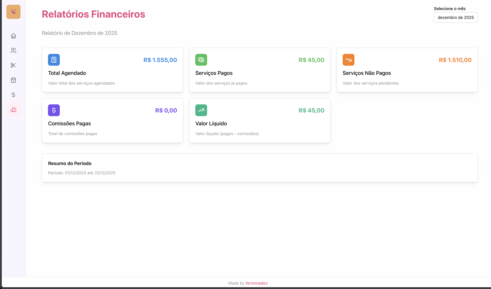
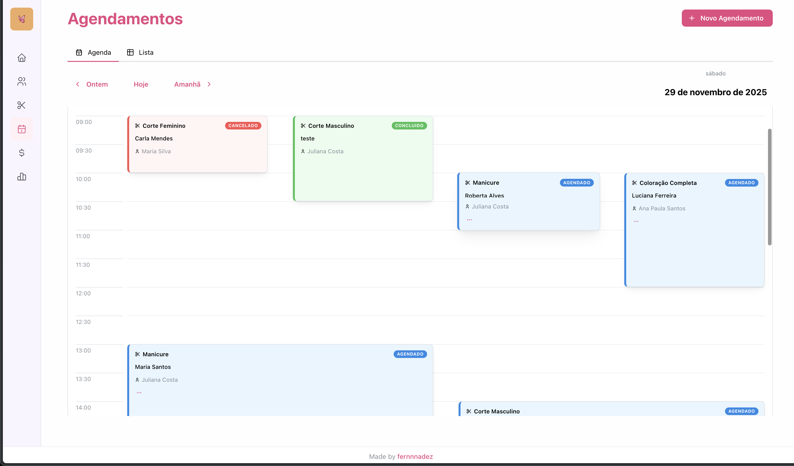
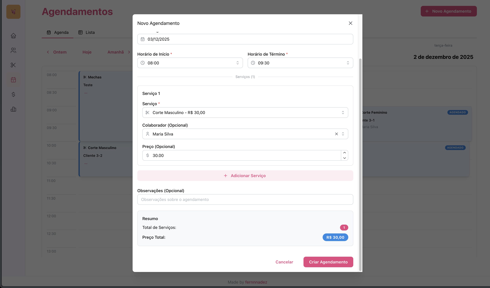

# 💅 Ageendoo

Sistema completo de gestão para salões de beleza, com agendamentos, colaboradores, serviços, comissões automáticas, despesas e relatórios financeiros.

> O repositório ainda se chama `beauty-express` (nome técnico). O produto é o **Ageendoo**.

## 📋 Sobre o Projeto

- **Gestão de Colaboradores** — cadastro, serviços associados, ativação/desativação e login próprio (perfil `collaborator`, com visão da própria agenda e comissões)
- **Catálogo de Serviços** — preços, descrição, percentual de comissão por serviço e associação com colaboradores
- **Agendamentos** — múltiplos serviços, horários, status e registro retroativo
- **Comissões** — cálculo automático ao concluir serviços, regime de período (quinzenal/mensal), alertas de atraso e controle de pagamento
- **Despesas** — custos fixos (recorrentes) e esporádicos, por categoria
- **Relatórios Financeiros** — visão mensal/por período de receita, comissões, despesas e lucro líquido
- **Central de ajuda** — manual integrado no app
- **PWA** — instalável no celular/desktop
- **Atendimento via WhatsApp** — 🚧 em desenvolvimento (branch `feat/whatsapp`, ainda não em produção)

## 📸 Screenshots

| Dashboard | Agendamentos | Novo Agendamento |
|-----------|--------------|------------------|
|  |  |  |

## 🏗️ Arquitetura

Monorepo com **API REST** e **frontend SPA** independentes:

```
beauty-express/
├── api/                  # NestJS 11 + TypeORM + PostgreSQL
├── frontend/             # React 19 + Vite (PWA) + Mantine
├── landing/              # Site de divulgação (React + Vite)
├── api/docker-compose.yml  # PostgreSQL local
└── docs/
    ├── DEPLOY.md         # Guia de implantação
    └── MULTI_TENANT.md   # Roadmap multi-tenant
```

```
┌──────────────┐     HTTP (CORS)      ┌──────────────┐
│   Frontend   │ ──────────────────►  │     API      │
│  :5173 dev   │                      │   :3000      │
│  Vite/React  │                      │   NestJS     │
└──────────────┘                      └──────┬───────┘
                                           │
                                    ┌──────▼───────┐
                                    │  PostgreSQL  │
                                    │    :5432     │
                                    └──────────────┘
```

### Backend (`api/src`)

```
application/    # Controllers, DTOs
domain/         # Entities, Repositories, Services, Modules
config/         # database.config.ts
scripts/        # seed.ts
```

### Frontend (`frontend/src`)

```
components/     # UI por domínio (appointment, collaborator, service), PwaInstallPrompt
pages/          # Dashboard, Colaboradores, Serviços, Agendamentos, Clientes,
                #   Despesas, Relatórios, Configurações, manual/ (central de ajuda)
collaborator/   # Experiência mobile do profissional (agenda + comissões)
hooks/          # React Query
services/       # Cliente HTTP (Axios)
```

## 🚀 Tecnologias

| Camada | Stack |
|--------|-------|
| **API** | NestJS 11, TypeORM, PostgreSQL, Swagger, Jest, WebSocket (socket.io) |
| **Frontend** | React 19, Vite 7 (PWA), Mantine 8, TanStack Query, Luxon, dayjs, socket.io-client |
| **Infra** | Docker Compose (Postgres local), plataformas gerenciadas (produção) |

## 🛠️ Instalação e Desenvolvimento

### Pré-requisitos

- Node.js 20+
- npm
- Docker (para PostgreSQL local)

### 1. Banco de dados

```bash
cd api
npm run db:up
```

Isso sobe o PostgreSQL via `api/docker-compose.yml`.

### 2. API

```bash
cd api
npm install
cp .env.example .env
npm run start:dev
```

Opcional — popular com dados de exemplo:

```bash
npm run seed
```

- API: `http://localhost:3000`
- Swagger operacional: `http://localhost:3000/docs`
- Swagger backoffice: `http://localhost:3000/docs/admin`

### 3. Frontend

```bash
cd frontend
npm install
cp .env.example .env
npm run dev
```

- App operacional: `http://localhost:5173`
- Backoffice (super admin): `http://localhost:5173/backoffice/login`
- Conecta à API em `http://localhost:3000` (variável `VITE_API_URL`)

> A API precisa estar rodando antes do frontend.

### Autenticação (multi-tenant)

| App | URL | Quem acessa |
|-----|-----|-------------|
| Operacional | `/login` | `admin` ou `collaborator` de **um tenant** |
| Backoffice | `/backoffice/login` | **Super admin** apenas |

Papéis: `super_admin`, `admin`, `collaborator`. O login operacional é por e-mail+senha (sem seleção de filial/portal); o `collaborator` tem login próprio e vê apenas a própria agenda e comissões.

**Credenciais do seed (dev):** o seed cria 4 tenants demo (`paulista` "Espaço Bella", `recife`, `boaviagem`, `barbearia-lucas`).

| Papel | E-mail | Senha |
|-------|--------|-------|
| Super admin | `owner@beautyexpress.com` | `SenhaAdmin123!` |
| Admin Paulista | `admin@paulista.mariaborboleta.com` | `Senha123!` |
| Admin Recife | `admin@recife.mariaborboleta.com` | `Senha123!` |
| Admin Boa Viagem | `admin@boaviagem.mariaborboleta.com` | `Senha123!` |
| Admin Barbearia | `admin@barbearia.fernnandez.com` | `Senha123!` |

Reset completo do banco + seed:

```bash
cd api && npm run db:reset && npm run seed
```

### Variáveis de ambiente

**`api/.env`** (veja `.env.example`):

```env
PORT=3000
CORS_ORIGIN=http://localhost:5173
DB_HOST=localhost
DB_PORT=5432
DB_USERNAME=postgres
DB_PASSWORD=postgres
DB_DATABASE=beauty_express
DB_SYNCHRONIZE=true
JWT_ACCESS_SECRET=change-me-access-secret
JWT_REFRESH_SECRET=change-me-refresh-secret
THROTTLE_LOGIN_LIMIT=10
THROTTLE_LOGIN_TTL_MS=60000
```

**`frontend/.env`**:

```env
VITE_API_URL=http://localhost:3000
```

## 📦 Funcionalidades

### Agendamentos
- Criação com múltiplos serviços e preços customizados
- **Registro retroativo** — datas passadas exigem serviço + colaborador e concluem automaticamente (gera comissões)
- Conclusão, cancelamento e filtro por data

### Comissões
- Cálculo automático pelo percentual de comissão **do serviço**
- Regime de período configurável (quinzenal/mensal) e alertas de comissão atrasada
- Filtros por período, colaborador e status de pagamento
- Marcação em lote como paga/não paga

### Despesas
- Custos fixos (recorrentes, com dia de vencimento e vigência) e esporádicos
- Categorias (aluguel, contas, salários, insumos, impostos, marketing, outros)

### Relatórios
- Relatório mensal/por período com receita, comissões, **despesas e lucro líquido**
- Séries temporais (semestre/ano) e ranking de serviços mais realizados

## 🧪 Testes

```bash
cd api
npm test              # ~293 testes
npm run test:cov      # Com cobertura
```

## 📚 API

| Documentação | URL |
|--------------|-----|
| Operacional | `http://localhost:3000/docs` |
| Backoffice | `http://localhost:3000/docs/admin` |

### Endpoints principais

| Recurso | Exemplos |
|---------|----------|
| Auth operacional | `POST /auth/login`, `POST /auth/refresh` |
| Auth backoffice | `POST /auth/admin/login` |
| Admin | `GET /admin/tenants`, `POST /admin/users`, `GET /admin/audit-logs` |
| Colaboradores | `GET/POST /collaborators` |
| Serviços | `GET/POST /services` |
| Agendamentos | `GET/POST /appointments`, `PUT /appointments/:id/complete` |
| Serviços agendados | `POST /scheduled-services/appointment/:id` |
| Comissões | `GET /commissions`, `PUT /commissions/mark-as-paid` |
| Despesas | `GET/POST /expenses`, `PUT/DELETE /expenses/:id` |
| Relatórios | `GET /financial-reports/monthly?year=2026&month=6`, `/financial-reports/period`, `/timeseries`, `/top-services` |

Logins têm rate limit configurável (`THROTTLE_LOGIN_LIMIT` / `THROTTLE_LOGIN_TTL_MS`). Ações do backoffice são registradas em `admin_audit_logs`.

## 🗄️ Banco de Dados

**PostgreSQL 16** com entidades:

- `Tenant`, `User`, `Collaborator`, `Service`, `Appointment`, `ScheduledService`, `Commission`, `Client`, `Expense`

Em desenvolvimento, `DB_SYNCHRONIZE=true` cria/atualiza o schema automaticamente. Em produção, use `DB_SYNCHRONIZE=false` + migrations.

## 🚀 Implantação

API e frontend são implantados **separadamente**:

- **API** — Railway, Render, Fly.io ou similar + PostgreSQL gerenciado
- **Frontend** — Vercel, Netlify ou CDN (build estático)

Em produção, recomenda-se subdomínios distintos: `app.` (filiais) e `admin.` (backoffice), com `CORS_ORIGIN` listando ambas as origens.

Guia completo: **[docs/DEPLOY.md](./docs/DEPLOY.md)**

## 💬 Atendimento via WhatsApp — 🚧 em desenvolvimento

> Disponível **apenas na branch `feat/whatsapp`** e **ainda não em produção**.

Módulo de inbox de WhatsApp usando a **Evolution API** (não oficial): conversas + chat, pareamento por QR, status de entrega (tiquinhos), reações, recebimento de mídia (figurinha/imagem), buckets de conversa (agendado/cliente/novo contato), busca, iniciar conversa a partir de um cliente, vincular/criar cliente, preparar confirmação de agendamento, catálogo de preços e respostas rápidas configuráveis, badge de não lidas e tempo real via WebSocket (namespace `/whatsapp`).

Dev: `cd api && npm run evolution:up` sobe Evolution + Postgres + Redis (`api/docker-compose.evolution.yml`). Envs: `EVOLUTION_API_URL`, `EVOLUTION_API_KEY`, `EVOLUTION_WEBHOOK_PUBLIC_URL`, `EVOLUTION_WEBHOOK_TOKEN` (veja `api/.env.example`).

## 🔮 Roadmap

Plano de auth e multi-tenant: **[docs/PLANO_AUTH_MULTI_TENANT.md](./docs/PLANO_AUTH_MULTI_TENANT.md)**.

## 📝 Licença

Projeto privado de uso interno.

---

**Ageendoo** — Gestão completa para seu salão de beleza 💅✨
